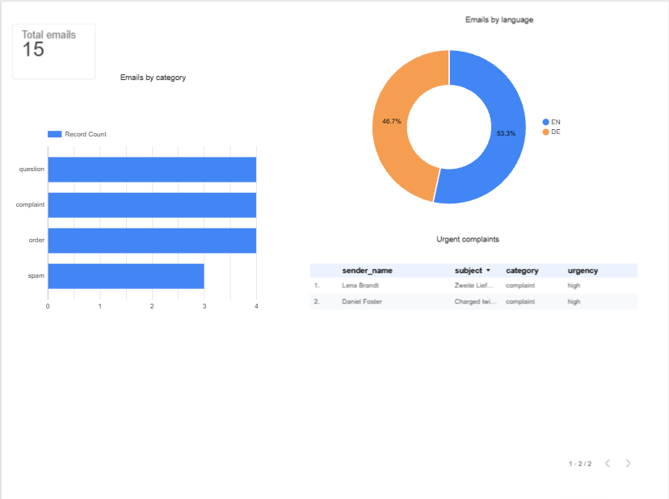

# AI Email Triage with n8n and Gemini

An n8n workflow that reads support emails from a Gmail label, classifies each one with Google Gemini (category, urgency, language), logs the result to Google Sheets, sends an alert for urgent complaints, and shows everything in a dashboard.

**All data is synthetic.** The 15 demo emails are fictional (a made-up coffee shop, "Kaffeewerk Demo"). No real customer or personal data is used.



## The question

Can a free AI model sort a small support inbox well enough to (1) route emails by type, (2) flag the urgent complaints that need a fast reply, and (3) work in both German and English, using only low-code tools and free tiers?

## Data

- 15 fictional emails, 7 in German and 8 in English (`data/demo_emails.md`).
- Mix: 4 complaints, 4 questions, 4 orders, 3 spam.
- Includes edge cases on purpose: a spam email that says "URGENT", a complaint that also asks a question, and a question that needs an answer before shipping.
- Expected labels written by hand in `data/ground_truth.csv`, used to measure accuracy.
- The emails were sent to my own Gmail account and labelled `Support-Demo`. A first line in each body (`From: Name <address>`) holds the fake sender, because Gmail shows my own address as the sender.

## How it works

```
Gmail label "Support-Demo"
        |
   Get many messages -> Loop Over Items (1 email at a time)
                              |
                      Gemini (gemini-3.5-flash-lite)
                              |
                       Wait (5 seconds)  -> back to the loop
                              |
              Code (parse the JSON answer into columns)
                              |
                   Google Sheets (append row)
                              |
                If: category = complaint AND urgency = high
                              |
                  Gmail "Send a message" (alert)

Google Sheets  ->  Data Studio / Looker Studio dashboard
```

- **Prompt:** Gemini gets the subject and body and must return only JSON: `category` (complaint / question / order / spam), `urgency` (high / medium / low), `language` (DE / EN), `sender_name`, and a one-sentence `summary`. The prompt has simple rules: pick the main intent, spam is always low urgency, "high" only for a clear deadline, a money problem or a legal threat.
- **Rate limits:** the free Gemini tier allows 15 requests per minute for this model, so the loop sends one email every 5 seconds.
- **Alert:** an If node sends an email for every high-urgency complaint.
- **Dashboard:** four charts: total emails, emails by category, emails by language, and a table of urgent complaints.

## Results

Compared with my hand-written labels (`data/accuracy_check.csv`):

| Field | Correct |
|---|---|
| Category | 15 / 15 |
| Urgency | 15 / 15 |
| Language | 15 / 15 |
| Sender name (from the first line) | 15 / 15 |

- Urgent alerts: 2 of 2 urgent complaints found (Daniel Foster, EN, double charge; Lena Brandt, DE, damaged delivery with a legal threat). No false alarms.
- Category counts in the dashboard: question 4, complaint 4, order 4, spam 3. Language split: EN 8, DE 7.
- The three edge cases (fake "URGENT" spam, complaint plus question, question with a shipping deadline) were all labelled correctly.

## Limitations

- **Tiny, easy test set.** 15 emails that I wrote myself. 15/15 shows the pipeline works, but it does not prove the same accuracy on real, messy emails. A real test needs far more emails and several labelled by someone else.
- **Free-tier limits.** A free Gemini model allows only a small number of requests per minute and per day. The first runs failed with "too many requests" until I added the loop and the 5-second wait. A bigger inbox needs a paid plan or batching.
- **No duplicate protection.** The Sheets step only appends rows. Running the workflow twice on the same emails writes them twice. A real version should check the message ID first.
- **Live trigger not tested in production.** The workflow also contains a Gmail Trigger for new emails. I tested with the manual batch path (Get many messages) and did not publish the live version. With one email at a time the loop sends it to Gemini twice, which should be fixed before real use.
- **Alert goes only to my own address.** It is a demo and not connected to a ticket system or chat.
- **Dashboard** reads the Google Sheet and is private. The screenshot is the only public copy.

## Project structure

```
n8n-ai-email-triage/
├── README.md
├── .gitignore
├── workflow/
│   └── ai-email-triage.json      # exported n8n workflow (no secrets)
├── data/
│   ├── demo_emails.md            # the 15 fictional emails
│   ├── ground_truth.csv          # expected labels
│   └── accuracy_check.csv        # expected vs predicted, row by row
└── screenshots/
    ├── dashboard.png
    ├── workflow.png
    └── sheet.png
```

## Tools

n8n Cloud, Google Gemini API (free tier), Gmail, Google Sheets, Data Studio (Looker Studio), JavaScript (one Code node).

## How to run it yourself

1. Import `workflow/ai-email-triage.json` in n8n.
2. Create your own credentials: Gmail (OAuth), Google Sheets (OAuth), Google Gemini API key. **Never commit keys.**
3. Create a Gmail label `Support-Demo` and send the demo emails to yourself with that label.
4. Create a Google Sheet with the columns: `received, message_id, sender_name, subject, category, urgency, language, summary`, and select it in the Sheets node.
5. Run from the Manual Trigger.
